# Architecture Report: Parent Platform 'Keshet's Kennel' (המלונה של קשת) v4.0
## Domain Libraries & AI Architecture Advisor Edition

> [!IMPORTANT]
> **Complete System Isolation, Malinois Mascot Branding, Security, and Governance Established:**
> * **Parent Platform URL:** [keshets-kennel.netlify.app](https://keshets-kennel.netlify.app) (Site ID: `b4dfb436-da3e-4f1c-aa9b-260a8ea195bb`)
> * **Managed Child Application (Artisan Confectionery):** [artisan-bakery-management.netlify.app](https://artisan-bakery-management.netlify.app) (Site ID: `c6927a30-6175-4b05-8313-7472f46a3a44`)
> * **Standalone Bakery Calculator (The Bakery House):** [the-bakery-house-app.netlify.app](https://the-bakery-house-app.netlify.app) (Site ID: `92ada39a-453a-48fe-aa97-04f537f0978d`)
> * **Super Admin Identity:** `yhaim11@gmail.com` | Primary Emergency Contact: `052-2205724` (`0522205724`)
> * **Master Password:** Cryptographically protected using Salted SHA-256 Hashing only — Zero Plaintext Visibility.
> * **Royal Belgian Malinois Mascot Branding:** High-resolution 512x512 assets with complete HTTP 200 verification across all endpoints.

---

## 🏗️ Comprehensive System Architecture Diagram

```mermaid
flowchart TD
    subgraph CorePlatform["🏢 Parent Platform: Keshet's Kennel (keshets-kennel.netlify.app)"]
        SuperAdmin["👑 Super Admin (yhaim11@gmail.com)"]
        AuthModule["🔐 Secure Gateway (Zero Hardcoded PINs, 2FA Email OTP, Custom Styled Keypad)"]
        ResetHub["🔑 Secure Password Reset (Forgot Password ➔ 2FA OTP ➔ Salted Hash Reset ➔ Rate Limiter)"]
        SecHub["🛡️ Super Admin Profile & Credential Security Hub"]
        Dashboard["📊 Central Governance Dashboard (Slim Cards, Exclusive Revenue Routing)"]
        DomainLibs["📚 5 Professional Domain Libraries: Operations, Billing, Security, Chat, Events"]
        AiAdvisor["🧠 AI Architecture Advisor Engine (Freeform Prompt Mapping & Engineering Specs)"]
        GovEngine["⚙️ Governance & Child Application Control Engine"]
        SuperAdminBillingCtrl["💳 Subscription & Billing Control Center (Plan & Fee Manager)"]
        PipelineEngine["📂 Automation Pipeline: File-to-Agent"]
        ChatEngine["💬 E2EE Real-time Communication Center (Read Receipts, Task Groups)"]
        EventsHub["📅 Events Hub & Team Shift Scheduler"]
        EmergencyEngine["🛑 Emergency Control Engine (Kill Switch, Auto-Demo, Data Freeze Archive)"]
    end

    subgraph ChildApps["📦 Managed Child Applications"]
        subgraph ConfectioneryApp["🥐 Artisan Confectionery Management (artisan-bakery-management.netlify.app)"]
            BakeryMascot["🐕 Royal Malinois Mascot (HTTP 200 Assets)"]
            BakeryBillingWidget["💳 Direct Billing & Subscription Widget (Direct Route to yhaim11@gmail.com)"]
            BakeryZeroPass["🔒 Zero Password Visibility (Salted SHA-256 Hash)"]
            BakeryReceipts["🧾 Official Digital Receipt Generator"]
            BakeryOvens["🔥 Morning Shift & Oven Operation Management"]
            BakeryShowcase["🍰 Display Showcases & Refrigerated Inventory"]
        end
        AjnaApp["👁️ AJNA - Computer Vision & Artificial Intelligence"]
    end

    subgraph StandaloneClientApp["🥖 The Bakery House - Standalone Baker's App (the-bakery-house-app.netlify.app)"]
        SmartCalc["🧮 Smart Baker's Calculator (True Baker's Percentages, Units & Flour Modes)"]
        FermOffset["⚖️ Multi-System Fermentation Offsets (Liquid Sourdough, Pasta Madre, Yeast, Hybrid)"]
        RecipeArsenal["📖 Boutique Recipe Arsenal with Complete Chronological Stages"]
        ZeroAdminLeak["🛡️ 100% Client Isolation: Zero Admin Buttons, Zero Plaintext Passwords, No Backend Leaks"]
    end

    SuperAdmin --> AuthModule
    AuthModule --> Dashboard
    Dashboard --> SecHub
    Dashboard --> DomainLibs
    Dashboard --> AiAdvisor
    Dashboard --> GovEngine
    Dashboard --> SuperAdminBillingCtrl
    Dashboard --> PipelineEngine
    Dashboard --> ChatEngine
    Dashboard --> EventsHub
    Dashboard --> EmergencyEngine

    DomainLibs -.->|Modular Feature Allocation| ChildApps
    AiAdvisor -.->|Dispatch Custom Feature Specs| PipelineEngine
    SuperAdminBillingCtrl -.->|Set Plans, Billing Cycles, Add-ons & Auto-Demo| BakeryBillingWidget
    BakeryBillingWidget -.->|Direct Payments & Digital Receipts| SuperAdmin
    EmergencyEngine -.->|Auto-Demo Grace Period or Kill Switch Lockdown| ChildApps
    CorePlatform -.->|Strict Architecture Separation| StandaloneClientApp
```

---

## 🐕 1. Royal Belgian Malinois Mascot & Resilient Branding
* **100% HTTP 200 Verified Assets:** All images are packaged using POSIX-compliant forward slashes for Linux/Netlify hosting.
* **Dual-Source Fallback System:** All `` tags implement resilient fallback:
  `onerror="this.onerror=null;this.src='apple-touch-icon.png'"`
* **Live Network Verification:**
  - `https://artisan-bakery-management.netlify.app/app-logo.png` -> **HTTP 200**
  - `https://keshets-kennel.netlify.app/apple-touch-icon.png` -> **HTTP 200**
  - `https://the-bakery-house-app.netlify.app/app-logo.png` -> **HTTP 200**
* **Mascot Authenticity:** Portrays exclusively 'Keshet', the royal Belgian Malinois with caramel-tan coat, pitch-black mask, erect alert ears, and gold collar.

---

## 🧠 2. AI Architecture Advisor Engine
* **Semantic Analysis & Freeform Prompting:** Super Admin inputs custom business concepts (fleet logistics, medical clinics, fitness studios, educational portals).
* **Smart Domain Mapping:** Automatically maps requirements to the 5 Core Domain Libraries with an `⚡ Auto-Apply Recommendations` trigger.
* **Custom Engineered Module Dispatch:** Generates structured technical specifications (REST/WebSocket API contracts, security architectures, microservices, priority ratings, and dispatch to development backlog).

---

## 📚 3. Five Domain Libraries (Modular System)
1. **Operations Hub:** Recipes, baking formulas, mixer schedules, production audit logs, and operational reports.
2. **Billing & Finance:** Subscriptions, recurring charges, direct Super Admin revenue routing (`yhaim11@gmail.com`), credit card clearing, and Apple Pay.
3. **Security & Auth:** Multi-factor authentication (2FA), Role-Based Access Control (RBAC), secure password resets, and Salted SHA-256 password hashing.
4. **Chat & Collaboration:** End-to-end encrypted messaging, double-checkmark read receipts, and file attachments.
5. **Events & Teams:** Event calendar, shift scheduling, and smart task reminders.

---

## 🛡️ 4. Strict Infrastructure Isolation Matrix
| System | Netlify Live URL | Netlify Site ID | Primary Audience & Function |
| :--- | :--- | :--- | :--- |
| **🛡️ Keshet's Kennel** | `https://keshets-kennel.netlify.app` | `b4dfb436-da3e-4f1c-aa9b-260a8ea195bb` | **Parent SaaS Platform:** Super Admin management, billing routing, governance, AI advisor. |
| **🥐 Artisan Confectionery** | `https://artisan-bakery-management.netlify.app` | `c6927a30-6175-4b05-8313-7472f46a3a44` | **Child Bakery Management:** Ovens, showcases, staff shifts, operations. |
| **🥖 The Bakery House** | `https://the-bakery-house-app.netlify.app` | `92ada39a-453a-48fe-aa97-04f537f0978d` | **Standalone Baker's App:** Smart Baker's Calculator, recipe formulas, zero admin leaks. |

---

## 🔒 5. Zero-Leak Security Governance
* **Client UI Purity:** The Bakery House client interface is purely operational for bakers. It must NOT contain administrative tabs, database editor screens, password hints, or plaintext credentials.
* **Administrative Ownership:** All content management, recipe curation, and system-wide configurations are restricted exclusively to Keshet's Kennel.
